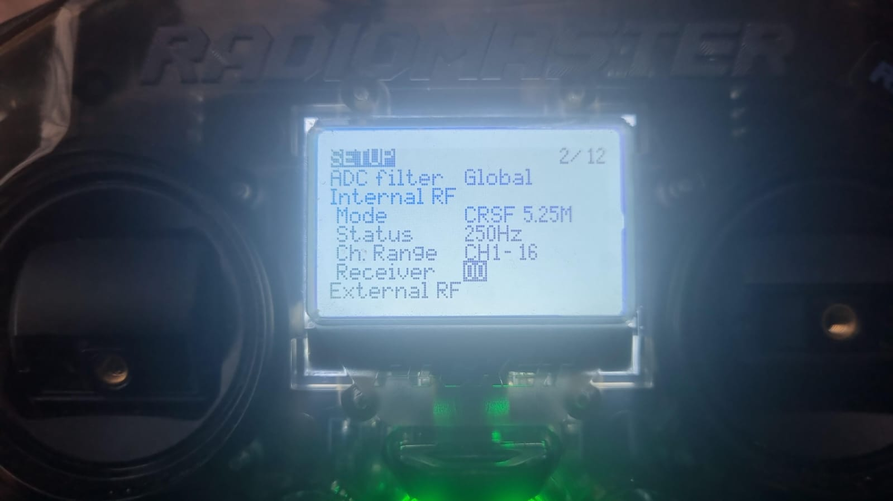
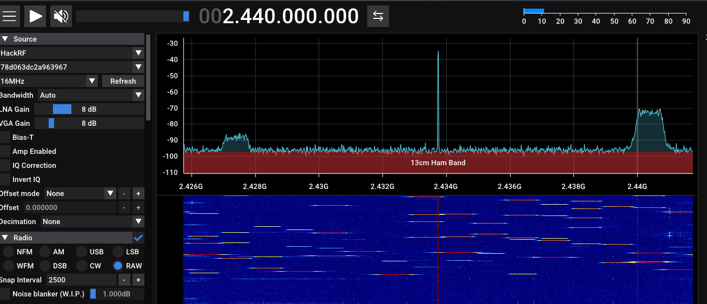

# 01 — Radiocontrol: ExpressLRS 2.4 GHz

[← Project overview](../README.md) · [Presentation PDF](../presentation/BEYOND_THE_GOGGLES.pdf)

## Objective and scope

Document the observation and characterization of an **ExpressLRS 2.4 GHz radio-control link** from the RF layer, using HackRF One and Inspectrum. The aim is to investigate RF activity, timing and frequency behavior **without decoding the payload or modifying the drone firmware**.

This document distinguishes direct experimental observations from protocol-level context. Detecting activity at 2.4 GHz is not, by itself, proof that a signal is ExpressLRS.

## Equipment and software

| Item | Role |
| --- | --- |
| BetaFPV Meteor75 | FPV test drone with ExpressLRS 2.4 GHz |
| RadioMaster Pocket | Radio-control transmitter |
| HackRF One | IQ sampling and spectrum observation |
| Inspectrum | Offline temporal and spectral analysis |
| SDR++ | Additional RF visualization |
| M5Stick-C + NRF24L01 | Separate 2.4 GHz transceiver experiment |
| HackRF + PortaPack H2 + Mayhem | Additional experimental RF platform |

### Photographic evidence




## 1. Experimental architecture

```text
RadioMaster Pocket ─── 2.4 GHz ExpressLRS ───> Meteor75
                              │
                         RF observation
                              ▼
                          HackRF One
                              │
                         IQ samples
                              ▼
                          Inspectrum
                              │
                    Timing / RF analysis
```

The SDR captures a portion of the radio spectrum as IQ samples. Inspectrum is used to inspect the recorded signals offline. The SDR observation path is separate from the normal radio-control link.

## 2. RF activity: transmitter OFF vs ON

The radio transmitter was tested in two states:

1. **OFF:** characteristic activity associated with the experimental transmitter was absent from the observed capture.
2. **ON:** RF activity appeared in the observed band.

The comparison provides a correlation between transmitter state and recorded RF activity in the test conditions. Other emitters can occupy the same 2.4 GHz band, including Wi-Fi, Bluetooth and other RC systems.


## 3. Packet-rate / temporal periodicity

The recorded IQ signal was examined with Inspectrum. The experiment documented the following approximate values:

| Measurement | Value |
| --- | --- |
| Measured period | **3.968 ms** |
| Derived rate | **252.016 Hz** |
| Configured ELRS packet rate | **250 Hz** |
| Nominal interval at 250 Hz | **4 ms** |

The relation is:

```text
rate (Hz) = 1 / period (seconds)
1 / 0.003968 ≈ 252.016 Hz
1 / 0.004    = 250 Hz
```

The measured periodicity is consistent with the configured 250 Hz mode, within the resolution and conditions of this observation.

**Interpretation caution:** individual bright lines in a spectrogram must not automatically be counted as complete packets. This result concerns measured temporal periodicity, not decoded packet contents.



## 4. Frequency hopping

ExpressLRS uses frequency-hopping behavior. In the RF analysis, activity may appear at different frequencies over time. Relevant characteristics for investigation include:

- Center frequency and occupied bandwidth
- Signal duration and repetition period
- Frequency changes across the observation window
- Noise floor, interference and signal-to-noise conditions

This experiment did not decode the payload or reconstruct a complete hopping sequence. A limited SDR capture may show only part of a wider hopping pattern.

## 5. IQ capture and analysis

Conceptual capture workflow:

```text
RF emission → HackRF One → IQ file → Inspectrum → RF characterization
```

Example HackRF capture command (replace placeholders with values suitable for your own setup):

```bash
hackrf_transfer -r capture.iq -f <CENTER_FREQUENCY_HZ> -s <SAMPLE_RATE_SPS>
```

The command is a template, **not** a record of the exact parameters used in the experiment.

## 6. NRF24L01 experiment

A separate experiment used an **M5Stick-C with an NRF24L01** to produce or observe RF activity in the 2.4 GHz band and compare a dedicated transceiver with an SDR-based platform.

The NRF24L01 operates with discrete channel configurations, whereas an SDR provides a different level of flexibility for RF sampling and signal processing. These are different radio architectures and their effects cannot be compared solely by a single transmit-power or channel setting.

The experimental observation included degradation of ELRS link quality under some tested RF conditions. This is not evidence that the NRF24L01 decoded or took control of ExpressLRS.

## 7. HackRF + PortaPack / Mayhem

The additional experimental platform used HackRF One with PortaPack H2 and Mayhem. Configuration concepts discussed during the research included:

| Parameter | Conceptual role |
| --- | --- |
| WIDTH | Frequency span configured for the experiment |
| TYPE | Selected signal mode |
| HOP | Movement between configured frequency segments |
| TX | Transmission duration |
| SLEEP | Pause between operations |
| JITTER | Timing variation |
| GAIN | Gain setting |

These are descriptive concepts rather than a universal configuration recipe; exact behavior depends on the Mayhem application and version.

## 8. ELRS vs TBS: controlled observation

In a separate RF experiment, **ELRS showed a reduction in link quality (LQ)** under the tested conditions, while the tested **TBS link did not show a comparable reduction**.

This observation must not be interpreted as universal immunity, vulnerability or superiority of either protocol. Differences in transmit power, receiver sensitivity, antennas, distance, frequency, diversity and experiment geometry can materially change results.

## 9. Security context and limitations

NCC Group published research in 2022 discussing issues in the binding process and frequency-hopping sequence generation of ExpressLRS 1.x and 2.x. **This project does not reproduce that attack.** Its focus is observation and RF characterization.

### Conclusions

- HackRF and Inspectrum supported observable characterization of the experimental 2.4 GHz link.
- The measured **3.968 ms** periodicity was consistent with the configured **250 Hz** packet rate.
- The radio environment is shared: frequency and visible energy alone do not establish protocol identity.
- Link-quality changes are specific to the equipment and conditions tested.
- RF observation is a useful first stage for deeper security research, but it is not equivalent to payload decoding or exploitation.

---

[← Back to Beyond the Goggles](../README.md) · [Analog VTX research →](../02-vtx-analog-video/README.md)
