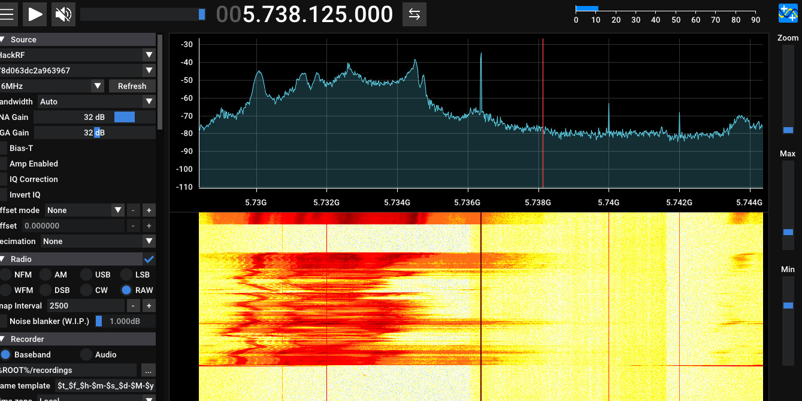

🌐 **Idioma / Language:** **Español** | [English](README_EN.md)

# 02 — Vídeo FPV analógico: VTX de 5.8 GHz

[← Volver al proyecto](../README.md) · [Presentación PDF](../presentation/BEYOND_THE_GOGGLES.pdf)

## Objetivo

Documentar la **observación RF y recepción de un enlace de vídeo FPV analógico** mediante HackRF One, una antena RHCP de 5.8 GHz y SDRangel.

Se busca caracterizar un transmisor de vídeo (VTX) de 5.8 GHz y explicar el proceso de demodulación analógica. **No se trata de romper cifrado digital**: el VTX evaluado transmite vídeo analógico.

## 1. Equipamiento experimental

| Componente | Función |
| --- | --- |
| BetaFPV Meteor75 | Dron FPV y fuente de vídeo |
| VTX analógico 5.8 GHz | Transmisor de vídeo RF |
| Raceband R3 | Canal experimental |
| **5732 MHz** | Frecuencia central del canal R3 |
| **25 mW** | Potencia configurada reportada en la prueba |
| Antena RHCP 5.8 GHz | Antena receptora |
| HackRF One | Receptor SDR |
| SDR++ | Inspección del espectro |
| SDRangel | Demodulación de televisión analógica (ATV) |

El radiocontrol ExpressLRS de 2.4 GHz es independiente del enlace de vídeo analógico de 5.8 GHz. Observar uno no implica decodificar ni comprometer el otro.

## 2. Arquitectura de recepción

```text
Cámara del Meteor75
      │
      ▼
VTX analógico (Raceband R3, 5732 MHz)
      │
      ▼
Transmisión RF de 5.8 GHz
      │
      ▼
Antena receptora RHCP
      │
      ▼
HackRF One
      │
      ▼
SDRangel / Demodulador ATV
      │
      ▼
Recepción de vídeo analógico
```

## 3. Observación RF

La primera etapa consiste en sintonizar el SDR cerca de la frecuencia configurada en el VTX e inspeccionar la energía y el espectro ocupado.

**Referencia experimental:** Raceband **R3 — 5732 MHz**.




Las capturas documentan la prueba. La presencia de energía cerca de una frecuencia no identifica por sí sola una transmisión de vídeo FPV; la configuración del transmisor y el resultado de la demodulación aportan contexto adicional.

## 4. Demodulación de vídeo con SDRangel

El procedimiento documentado fue:

1. Conectar el HackRF One y la antena receptora adecuada para 5.8 GHz.
2. Sintonizar el SDR en el canal del VTX (**5732 MHz**, Raceband R3).
3. Seleccionar una tasa de muestreo y un ancho de banda de recepción adecuados para el SDR y la señal.
4. Configurar el **demodulador ATV de SDRangel**, incluyendo el estándar de vídeo y los ajustes compatibles con la transmisión.
5. Inspeccionar y ajustar la recepción hasta recuperar una imagen reconocible.

El formato de vídeo y los parámetros del demodulador pueden requerir pruebas. Este documento no establece una configuración PAL/NTSC universal ni una tasa de muestreo exacta validada para todos los casos.

### Importancia de la recepción analógica

A diferencia de un sistema de vídeo FPV digital cifrado, un VTX analógico convencional no requiere una clave de descifrado digital para mostrar sus imágenes. Un receptor compatible y correctamente configurado puede demodular una señal suficientemente fuerte. La recepción depende de la polarización de las antenas, distancia, condiciones RF, ancho de banda y ajustes de demodulación.

## 5. Antena RHCP

**RHCP** significa *Right-Hand Circular Polarization* (polarización circular a derechas). La polarización influye en la recepción, especialmente al utilizar antenas compatibles con el sistema transmisor.

Una antena RHCP no aumenta la potencia de salida del VTX. Su ganancia, patrón de radiación y polarización afectan la señal recibida y, por tanto, la calidad de la demodulación.

## 6. Consideraciones de seguridad

Este experimento permite diferenciar dos superficies de comunicación FPV:

| Superficie | Observación experimental | Interpretación de seguridad |
| --- | --- | --- |
| Radiocontrol ExpressLRS, 2.4 GHz | Tiempos y comportamiento en frecuencia | Observar RF no equivale a decodificar tráfico de control |
| Vídeo VTX analógico, 5.8 GHz | Recepción de señal y demodulación ATV | El vídeo analógico compatible puede visualizarse sin descifrado digital |

La prueba ilustra una **característica de exposición de las transmisiones analógicas**, no una explotación del controlador de vuelo ni del enlace ExpressLRS.

## 7. Limitaciones

- Las observaciones corresponden a los equipos y condiciones documentados.
- La calidad de imagen depende de antenas, orientación, distancia, ruido y parámetros de recepción.
- No se rompió ningún mecanismo de cifrado digital.
- No se establecen conclusiones sobre sistemas digitales FPV como DJI o HDZero.
- La prueba no determina la seguridad de todos los sistemas VTX analógicos o digitales.

## 8. Conclusiones

- Se investigó el vídeo FPV analógico de manera independiente del radiocontrol de 2.4 GHz.
- El VTX documentado operó en **Raceband R3 (5732 MHz)**.
- HackRF One y SDRangel proporcionaron un flujo SDR para recibir y demodular vídeo analógico.
- La recepción analógica evidencia una posible limitación de confidencialidad en enlaces convencionales sin cifrado.
- La polarización de antena y la configuración del receptor son variables prácticas importantes.

---

[← Volver a Beyond the Goggles](../README.md) · [Investigación ExpressLRS →](../01-radiocontrol-elrs/README.md)
