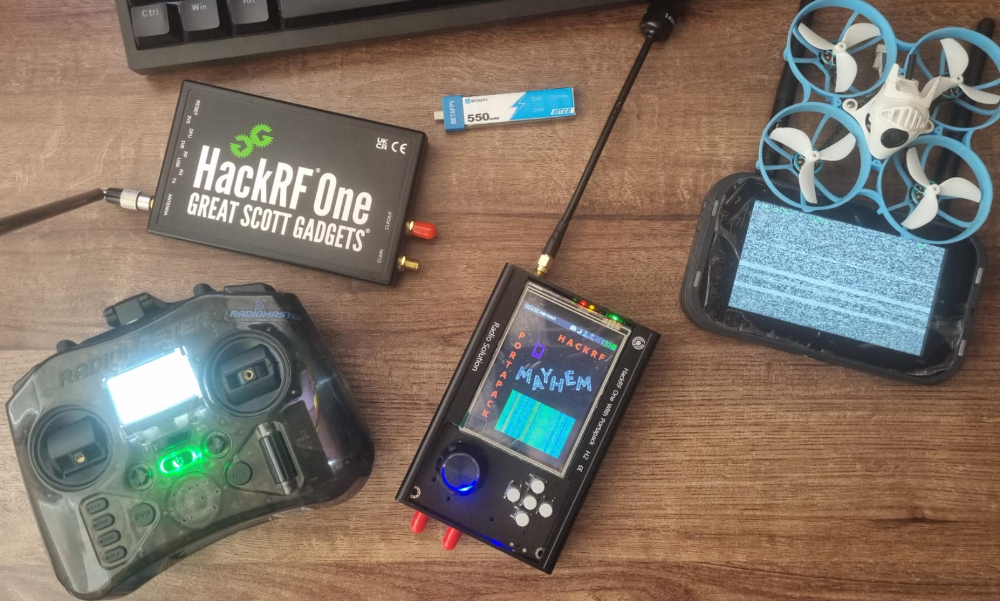
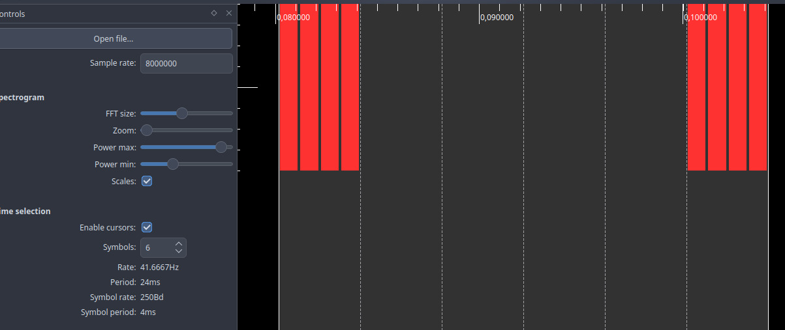
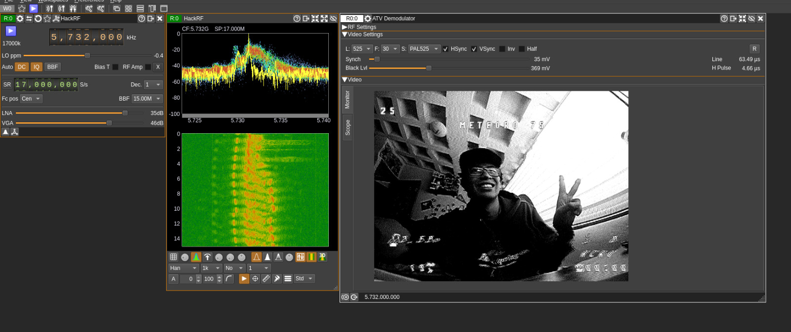

🌐 **Idioma / Language:** **Español** | [English](README_EN.md)

# BEYOND THE GOGGLES

### Hacking de drones FPV a través del espectro de radiofrecuencia

> El dron es mucho más de lo que vemos a través de las gafas.

**R4Gh0st // Matheo Camacho Vargas**  
Estudiante de Ingeniería en Ciberseguridad · Investigación RF/SDR · Piloto FPV  
**Pwn Or Die 2026 — Quito, Ecuador**

---

## Acerca de la investigación

¿Qué podemos aprender sobre un dron FPV observando sus señales de radio?

**Beyond the Goggles** documenta experimentos prácticos sobre dos superficies de comunicación independientes: el **enlace de radiocontrol ExpressLRS de 2.4 GHz** y el **transmisor de vídeo analógico (VTX) de 5.8 GHz**. Se estudian la observación RF, las capturas IQ, la caracterización de señales y la recepción de vídeo analógico, además de comparaciones experimentales entre equipos y enlaces.

Este repositorio es una bitácora de investigación; no pretende demostrar vulnerabilidades universales ni compromisos de protocolos.



## Experimentos

### 01 — ExpressLRS / Radiocontrol (2.4 GHz)

- Comparación de la actividad RF con el transmisor encendido y apagado.
- Capturas IQ con HackRF One y análisis posterior en Inspectrum.
- Periodicidad medida de aproximadamente **3.968 ms (252 Hz)**, coherente con un enlace configurado a **250 Hz**.
- Comportamiento de salto de frecuencia y limitaciones de identificar protocolos únicamente por su actividad RF.
- Experimentos con NRF24L01 y HackRF/PortaPack; observaciones sobre la calidad del enlace bajo condiciones concretas.



**[Consultar la investigación de ExpressLRS →](01-radiocontrol-elrs/README.md)**

### 02 — Vídeo FPV analógico / VTX (5.8 GHz)

- Observación RF de un transmisor de vídeo analógico.
- Canal experimental **Raceband R3 — 5732 MHz**.
- Recepción con HackRF One y antena RHCP de 5.8 GHz.
- Demodulación de vídeo mediante el módulo ATV de SDRangel.
- Consideraciones de seguridad de un enlace de vídeo analógico sin cifrado digital.



**[Consultar la investigación del VTX →](02-vtx-analog-video/README.md)**

## Equipamiento experimental

| Componente | Equipo o software | Propósito |
| --- | --- | --- |
| Dron FPV | BetaFPV Meteor75, ELRS 2.4 GHz, VTX analógico | Plataforma de pruebas |
| Radiocontrol | RadioMaster Pocket | Enlace ExpressLRS |
| SDR | HackRF One + PortaPack H2 | Observación y experimentación RF |
| Transceptor 2.4 GHz | M5Stick-C + NRF24L01 | Experimentos con radio dedicado |
| Antena | RHCP de 5.8 GHz | Recepción de vídeo |
| Análisis de señales | Inspectrum, SDR++ | Inspección del espectro y muestras IQ |
| Demodulación | SDRangel | Recepción de televisión analógica (ATV) |
| Otras herramientas | hackrf_transfer, Mayhem | Capturas y configuraciones experimentales |

## Arquitectura RF

```text
RadioMaster Pocket ── ExpressLRS 2.4 GHz ──> Meteor75
                           │
                           └──> HackRF One / IQ / Inspectrum
                                      (observación RF)

VTX analógico Meteor75 ── 5.8 GHz (R3: 5732 MHz) ──> Antena RHCP
                                                       │
                                                   HackRF One
                                                       │
                                                    SDRangel
                                                       │
                                                Recepción ATV
```

## Resultados destacados

| Observación | Interpretación |
| --- | --- |
| La actividad RF de 2.4 GHz se correlaciona con el estado del transmisor | Ayuda a caracterizar el montaje; no prueba que cualquier señal observada sea ELRS |
| Periodicidad medida de ~3.968 ms | Aproximadamente 252 Hz, compatible con 250 Hz; las líneas del espectrograma no se cuentan individualmente como paquetes |
| En una prueba, la calidad del enlace ELRS disminuyó y la del enlace TBS evaluado no mostró una reducción comparable | Resultado específico de esas condiciones; no demuestra superioridad ni inmunidad universal |
| Se recibió vídeo analógico mediante un flujo SDR | Recepción y demodulación analógica, **no** ruptura de cifrado digital |

## 🎥 Charla completa — Pwn Or Die 2026

La organización de **Pwn Or Die** publicó en YouTube la grabación de mi charla **BEYOND THE GOGGLES — The drone is more than what we see through the goggles**, presentada en Quito, Ecuador.

[](https://youtu.be/r7mYXfIT-SY)

▶️ **[Ver la charla completa en YouTube](https://youtu.be/r7mYXfIT-SY)**

## Presentación

**BEYOND THE GOGGLES — Pwn Or Die 2026, Quito**

[Ver la presentación (PDF)](presentation/BEYOND_THE_GOGGLES.pdf)

## Alcance y limitaciones

Las pruebas se realizaron con equipos bajo control del investigador. Los resultados dependen de las condiciones RF, antenas, distancia, potencia, configuración y diseño del receptor. La presencia de actividad en una banda no basta para identificar un protocolo, y una prueba aislada no establece propiedades generales de seguridad.

El proyecto documenta caracterización RF y observaciones experimentales. No reproduce la investigación publicada por NCC Group en 2022 sobre vulnerabilidades del proceso de vinculación y FHSS de ExpressLRS.

## Autor

**Matheo Camacho Vargas (R4Gh0st)**  
[GitHub](https://github.com/Ray1172004) · [LinkedIn](https://www.linkedin.com/in/matheo-camacho/)
